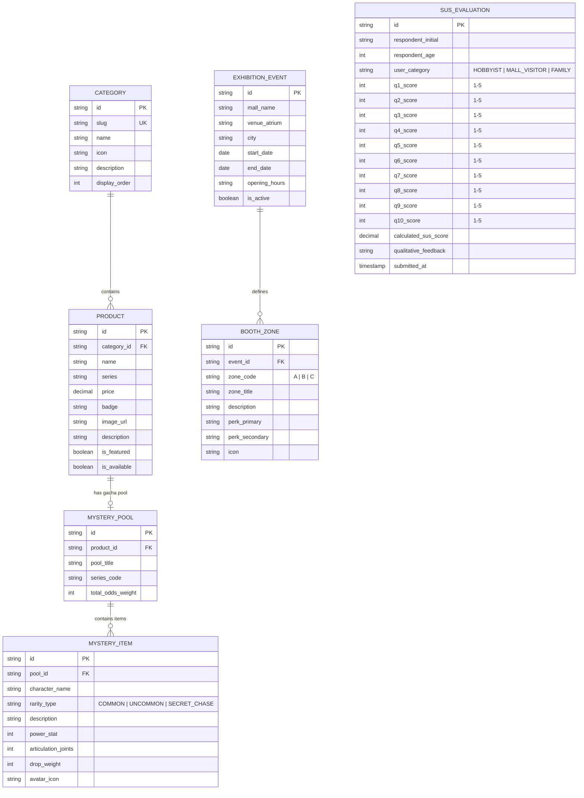

# Entity-Relationship & Data Schema Specification
## Project: Rickiest Toys & Hobby Shop Website

This document defines the data models, entity relationships, attribute types, and state enums used across the application (both for client-side state/mock data and potential backend integration).

---

## 1. Entity-Relationship Diagram (ERD)

---

## 2. Data Dictionary & Field Specifications

### 2.1 `PRODUCT` (Hobby Items & Collectibles)
* `id` (VARCHAR(36), PK): UUID identifier.
* `category_id` (VARCHAR(36), FK): References `CATEGORY.id`.
* `name` (VARCHAR(150)): Product commercial title (e.g., "Transformers Galaxy Vol. 01").
* `series` (VARCHAR(100)): Sub-franchise or wave name.
* `price` (DECIMAL(10,2)): Retail price in IDR (e.g., `129000.00`).
* `badge` (VARCHAR(50)): Promotional category tag (e.g., `BLIND BOX RESMI`, `BANDAI GUNPLA`, `OFFICIAL TCG`).
* `image_url` (VARCHAR(255)): Optimized asset path.
* `description` (TEXT): Concise product description (max 250 chars).
* `is_featured` (BOOLEAN): Flag for homepage showcase display.

### 2.2 `MYSTERY_ITEM` (Blind Box Gacha Simulator Roster)
* `id` (VARCHAR(36), PK): Unique item ID.
* `pool_id` (VARCHAR(36), FK): Associated mystery box pool.
* `character_name` (VARCHAR(100)): Full name (e.g., "Megatron Metallic Ver.").
* `rarity_type` (ENUM): `COMMON`, `UNCOMMON`, `SECRET_CHASE`.
* `power_stat` (INT): Integer rating `1-100`.
* `articulation_joints` (INT): Count of movable joints.
* `drop_weight` (INT): Odds probability weighting (e.g., Common = 70, Chase = 3).
* `avatar_icon` (VARCHAR(50)): Graphic/avatar symbol.

### 2.3 `EXHIBITION_EVENT` & `BOOTH_ZONE` (Mall Radar)
* `mall_name` (VARCHAR(100)): Mall venue (e.g., "Palembang Icon").
* `venue_atrium` (VARCHAR(100)): Specific location (e.g., "Main Atrium Ground Floor").
* `zone_code` (CHAR(1)): `A`, `B`, or `C`.
* `zone_title` (VARCHAR(100)): Zone name (e.g., "Diorama Showcase & Display").
* `perk_primary` / `perk_secondary` (VARCHAR(150)): Highlighted visitor perks.

### 2.4 `SUS_EVALUATION` (Multimedia Testing Instrumentation)
* Standard Brooke (1996) 10-item System Usability Scale instrument.
* Scores 1 (Strongly Disagree) to 5 (Strongly Agree).
* `calculated_sus_score`: Composite standard SUS score calculated via:
  $$\text{SUS Score} = 2.5 \times \left( \sum (Q_{\text{odd}} - 1) + \sum (5 - Q_{\text{even}}) \right)$$
